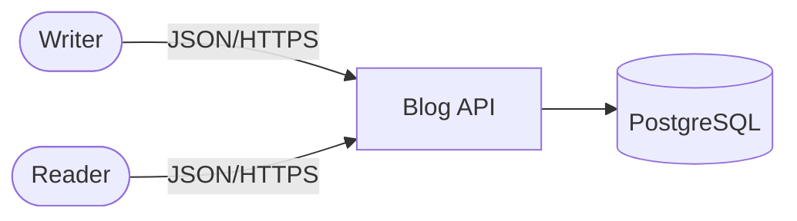

# Architecture

## Context

## Components

| Component | Responsibility | Owns |
|---|---|---|
| `routes/` | HTTP parsing, validation, status codes | request/response shapes |
| `middleware/auth` | Verify bearer JWT, attach `userId` | token verification |
| `services/` | Business rules (hashing, token issue, pagination) | domain logic |
| `models/` + `db/` | Queries and migrations | schema |

## Data flow

1. Request hits a route; the body is validated against the OpenAPI shape.
2. Protected routes pass through `middleware/auth` first.
3. The route calls a service; the service calls models.
4. Errors map to the status codes listed in 04-api-spec.yaml.

## Boundaries and rules

- Routes never touch the database directly — only through services/models.
- Only `services/auth` hashes passwords or signs tokens.
- Password hashes never leave the model layer.

## Decisions

- ADR-0001: PostgreSQL as the only datastore
- ADR-0002: Stateless JWT access tokens
