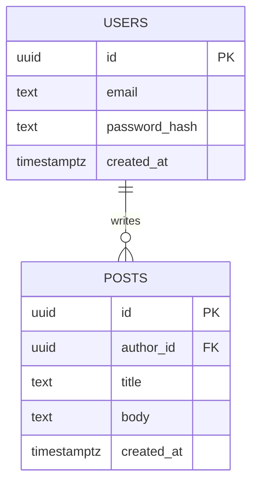

# Data Model

## Entities

## Tables

### users

| Column | Type | Constraints | Notes |
|---|---|---|---|
| id | uuid | PK, default `gen_random_uuid()` | API `User.id` |
| email | text | NOT NULL; unique index on `lower(email)` | API `User.email` |
| password_hash | text | NOT NULL | bcrypt; never exposed (NFR-2) |
| created_at | timestamptz | NOT NULL, default `now()` | API `User.created_at` |

### posts

| Column | Type | Constraints | Notes |
|---|---|---|---|
| id | uuid | PK, default `gen_random_uuid()` | API `Post.id` |
| author_id | uuid | NOT NULL, FK → users.id | API `Post.author_id` |
| title | text | NOT NULL, 1–200 chars (CHECK) | API `Post.title` |
| body | text | NOT NULL | API `Post.body` |
| created_at | timestamptz | NOT NULL, default `now()` | API `Post.created_at` |

Index `posts (created_at DESC, id DESC)` serves keyset pagination (ADR-0001).

## Migration plan

1. `0001_create_users` (T1) — rollback: drop table.
2. `0002_create_posts` (T4) — rollback: drop table.

Both are new tables, so rollback loses no existing data. Migrations are a gated
area: they run locally in phase 2, never against shared databases.
