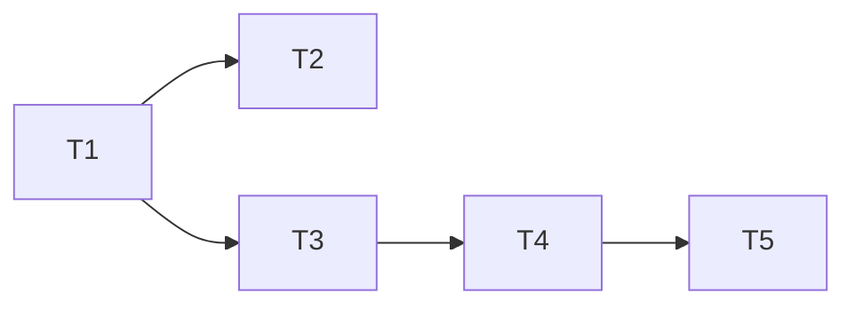

# Task Breakdown

## Dependency graph

## Tasks

### T1: User model + users migration

- Requirements: FR-1
- Depends on: none
- Skill: backend
- Areas: migration
- Spec: docs/specs/T1.md

### T2: POST /auth/register

- Requirements: FR-1
- Depends on: T1
- Skill: backend
- Areas: auth
- Spec: docs/specs/T2.md

### T3: POST /auth/login + auth middleware

- Requirements: FR-2
- Depends on: T1
- Skill: backend
- Areas: auth
- Spec: docs/specs/T3.md

### T4: Post model + posts migration + POST /posts

- Requirements: FR-3
- Depends on: T3
- Skill: api
- Areas: migration
- Spec: docs/specs/T4.md

### T5: GET /posts with cursor pagination

- Requirements: FR-4
- Depends on: T4
- Skill: api
- Areas: none
- Spec: docs/specs/T5.md
