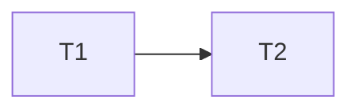

# Task Breakdown

## Dependency graph

## Tasks

### T1: API: count open todos

- Requirements: FR-1
- Depends on: none
- Skill: backend
- Repos: api
- Areas: none
- Spec: docs/specs/T1.md

### T2: Web: header shows the open todo count

- Requirements: FR-2
- Depends on: T1
- Skill: frontend
- Repos: web, root
- Areas: none
- Spec: docs/specs/T2.md
