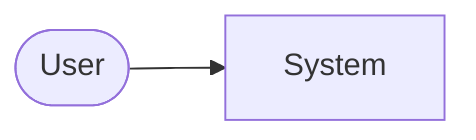

# Architecture

<!--
High-level design (C4 levels 1–2). Diagrams in Mermaid.
Every significant decision is referenced as `ADR-NNNN` and must exist in 03-adr/.
The headless reviewer reads this file on every review — keep it short and current.
-->

## Context

## Components

| Component | Responsibility | Owns |
|---|---|---|
| | | |

## Data flow

<!-- Main request paths, step by step. -->

## Boundaries and rules

<!-- What may call what; layering rules the reviewer must enforce. -->

## Decisions

<!-- - ADR-0001: <title> -->
