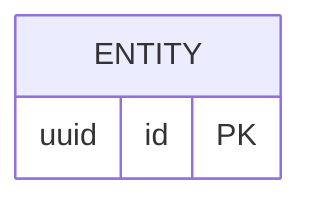

# Data Model

<!--
Entities, schema and migration plan. Field names and types must match
components.schemas in 04-api-spec.yaml.
-->

## Entities

## Tables

### <table>

| Column | Type | Constraints | Notes |
|---|---|---|---|
| | | | |

## Migration plan

<!-- Ordered migrations, and how each is rolled back. Migrations are a gated area. -->
