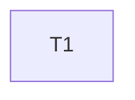

# Task Breakdown

<!--
WBS mapped 1-1 to plan.json tasks.
Conventions (read by the readiness check):
- One heading per task: `### T<n>: <title>`, same id as in plan.json.
- `- Requirements:` lists the FR ids the task serves (must match traceability.json).
- In a workspace (repos in orchestra.config.json), `- Repos:` lists the repos
  the task changes (root = the project directory); paths start with the repo's
  path.
- Keep tasks small enough for one agent and one review: one concern, a
  reviewable diff, its own tests.
-->

## Dependency graph

## Tasks

### T1: <title>

- Requirements: FR-1
- Depends on: none
- Skill: backend
- Areas: <!-- auth | payment | migration | … (empty if none) -->
- Spec: docs/specs/T1.md
